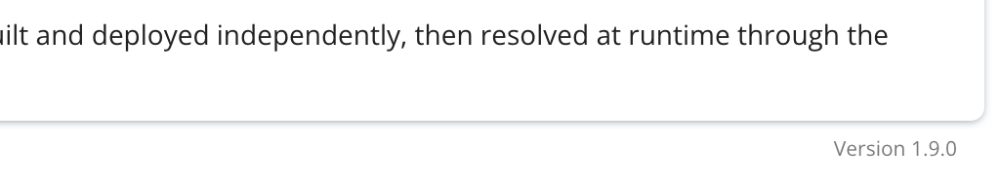

# Shipping a SPA as a site

The text of all 23 slides in `index.html`, with speaker notes. Generated by `./export-markdown.py 2026-12-shipping-a-spa-as-a-site`; don't edit by hand.

---

## 1. Shipping a SPA as a site

*Site platform · COREOPS-4535*

*Four phases, two release methods, and which one to choose*

*Noel Aguilar · DevOps 
December 2026*

**Speaker notes:** ⏱ 0.5 min. For product dev teams and leads who build SPAs and MFE host shells, and for DevOps. You know CI/CD, ArgoCD and AWS; what's new is modules/site and modules/site-function, the site-release chart, KeyValueStore routing and a few names. About 38 minutes, a live demo in the middle, then questions.

---

## 2. What you'll leave with

*Today*

- **The order of the work**: Four phases, what each one hands to the next.

- **Who owns each step**: Most of it is yours; DevOps does two steps and approves the units.

- **Which method fits your app**: In-place or versioned, and why you choose once.

- **Where the details live**: The how-to has every step; this deck is the map.

**Speaker notes:** ⏱ 1 min. Set expectations: this isn't the how-to read aloud. It's the order, the owners, the choice, and the few lines of config where the choice shows. Everything else is in the how-to, which we point to at the end. Two worked examples run through the deck: spa-example for versioned, on modules/site v2 in develop and staging, and SDS for in-place, on test1 and still on modules/site v1. Both are live.

---

## 3. A site is a hostname-rooted static origin

*What a site is*

- A **CloudFront distribution and an S3 bucket**, with DNS, its own certificate and the publisher's identity: `modules/site`, **per environment**
- A **viewer-request function**, plus a KeyValueStore for versioned: `modules/site-function`, **once per account**, attached by every environment's distribution
- It doesn't care what the files are

#### Delivered as a site today

- ✓ An SPA
- ✓ An MFE host shell whose MFEs ship in the same release (mfe-example)

#### Delivered another way

- → A frontend that runs as a pod: as an EKS workload
- → An independently released MFE: as a versioned asset on the shared CDN, loaded by its host site [coming]

**Speaker notes:** ⏱ 2 min. Four words, one line each. A frontend is what a team builds: browser code, however it's hosted. An SPA is a standalone frontend: it owns a hostname and users go to it directly. An MFE is loaded into an existing site at runtime and never has a hostname of its own. A site is where an SPA is published: a hostname-rooted static origin on S3 and CloudFront. Two modules make it: modules/site creates each environment's distribution, bucket, DNS records and certificate; modules/site-function creates the site's viewer-request function (and, for versioned, its KeyValueStore) once per account, and every environment's distribution in that account attaches it. Neither knows or cares whether the site holds an SPA, a Storybook or three HTML files. Today an SPA, or a shell whose MFEs ship in the same release, is delivered as a site: mfe-example is that shell, delivered the same way, and it stays on modules/site v1 until COREOPS-4759. A frontend that runs as a pod, like scheduling-frontend, is delivered like any EKS workload. Independently released MFEs will be supported, but not as sites: an MFE has no hostname, so it's published to the shared CDN as a versioned asset, and its host site's import map pins the version. That's a follow-on epic, not built yet; last content slide. Source: strategy §0, §4.0–4.2; how-to introduction.

---

## 4. One noun all the way through

*What a site is*

| What | Pattern | spa-example (versioned, develop) | SDS (in-place, test1) |
|---|---|---|---|
| ECR repository | `<product>/<app>-site` | `examples/spa-example-site` | `sds/sds-site` |
| Function unit | `platform/<app>-site-function` | `platform/spa-example-site-function` | none yet (v1) |
| Site unit | `application/<app>-site` | `application/spa-example-site` | `application/sds-site` |
| Hostname | `<app>.<env>.vsp-<account>.com` | `spa-example.develop.vsp-nonprod.com` | `test1.vectorsds-nonprod.com` |
| SSM prefix | `/<product>/<env>/site[/<app>]` | `/terragrunt-demo/dev/site/spa-example` | `/sds/test1/site` |
| Publisher ServiceAccount | `<app>-site-publisher` | `spa-example-site-publisher` | `sds-site-publisher` |
| Site chart | `helm/<app>` | `helm/spa-example` | `src/helm/sds-site` |

> `-site` means a data-only image: **published, never run**.

**Speaker notes:** ⏱ 1.5 min. The point: one noun, site, all the way through, so the same name always means the same thing. Walk the spa-example column; it follows the pattern. Two things to know: the ECR product (examples) and the Terraform product (terragrunt-demo) differ for spa-example, and the SSM prefix uses the Terraform environment (dev) where everything else uses the namespace (develop). The function unit lives in platform/, so DevOps approves every change to it; its function and store are named \<product>[-\<app>]-\<account-env>-site, terragrunt-demo-spa-example-nonprod-site for spa-example: the account (nonprod), not an environment, because every environment in the account shares them. staging has the same names with its own host and /terragrunt-demo/staging/site/spa-example. SDS differs, and that's expected, not the rule: it's the product's only site, so app and product are the same name and its SSM prefix has no app level; its hostname is on SDS's own product domain; and it's still on modules/site v1, so it has no function unit yet (it moves under COREOPS-4776). The -site suffix on an ECR repository tells you the image holds files and is never run: no server, no port, no Deployment. A frontend that runs as a pod doesn't carry -site. Also: the ApplicationSet is \<app>-appset and the Argo app \<env>-\<app>, e.g. develop-spa-example. Sources: how-to "Names"; SDS's sds-infrastructure and src/helm/sds-site.

---

## 5. Four phases, in this order

*The four phases*

![Four phases in two lanes, Product team and DevOps. Phase 1, infrastructure: the product team's function unit, once per account, passes the function to the site unit, one per environment, which creates the site; DevOps approves both units, and creates the ECR repository. Phase 2, app repository: build and chart, helm/app, fed by the unit's outputs. Phase 3, CI: builds one release image into the ECR repository. Phase 4, CD: DevOps registers the site with ArgoCD and the Promotion Manager once; each promotion passes the image tag to the Promotion Manager, and ArgoCD's sync runs the publisher Job, which publishes the site.](assets/diagrams/four-phases-light.svg)

The image is never run as a service: it holds the built files, and the Job copies them out.

**Speaker notes:** ⏱ 2 min. Left to right. Phase 1 creates the ECR repository, the site's function once for the account (the function unit), and the site in the lowest environment (the site unit); higher environments come later, with their first promotion. The site unit's outputs (the SSM prefix, the ServiceAccount, the hostnames) and, for versioned, the function's release_name fill in the chart in phase 2. Phase 3 turns the build into one release image. Phase 4 renders the chart with that image's tag and runs a Job in the cluster that publishes the files to the site. Two things that make a site different from an EKS workload: the image is never run as a service, and the same chart, ApplicationSet and Promotion Manager deliver both methods. The method is set twice and must match: routing in the function unit, and the values block in the chart. Source: how-to "The four phases".

---

## 6. Who does what

*The four phases*

| Phase | Produces | Who | Where |
|---|---|---|---|
| 1. Infrastructure | **Once per account:** the site's function, and its KeyValueStore for versioned (the function unit). **Once per environment, not per release:** the site (bucket, distribution, certificate, DNS), its SSM parameters, the publisher's role and ServiceAccount (the site unit). The ECR repository, once per app | Product team, DevOps approves (both units); DevOps (ECR) | `<product>-infrastructure` (`platform/`, `application/`); lvsf-infrastructure |
| 2. App repository | A build that fits the method; `Dockerfile`; `helm/<app>/` | Product team | The app's repository |
| 3. CI | The release image in ECR, built once per version | Product team | `.github/workflows/` |
| 4. CD | The ArgoCD registration, once; then each promotion publishes a release | DevOps (registration); product team (promotions) | argo-app-of-apps; Promotion Manager UI |

> Teams do most of this themselves, starting with the function unit and the site unit in their own infrastructure repo.

**Speaker notes:** ⏱ 1.5 min. Phase 1 is setup, not part of every release: one function unit per app (leaves nonprod and prod), one site leaf per app and environment (develop, staging, prod each get their own), and one ECR repository per app, shared by every environment. After that, a release is only phases 3 and 4. The two DevOps steps: the ECR repository (one line in lvsf-infrastructure's repo_list.tf, in core-resources, us-east-2; the product's eks_cluster_accounts must include every publishing cluster's account) and the ArgoCD registration (one argo-app-of-apps PR: the ApplicationSet and the promotion config). DevOps also approves the units through code owners: the function unit is in platform/, which only DevOps can approve, and so is every later change to its routing, API prefixes or redirects. A higher environment, like staging, adds its own site leaf when it's first promoted, and DevOps approves that too. Everything else is the product team's. An in-place app whose bundle sits inside its API image could skip the ECR repository; no app does that yet. Source: how-to "Who does what", steps 1 and 8.

---

## 7. In-place replaces files; versioned moves a pointer

*Two methods*

![What a release does. In-place: copy the build with nothing deleted yet, write the entry files index.html and the files: entries no-cache, invalidate /* and wait for it, sweep the files the build dropped, then every hostname is live on the new build. Versioned: upload the release folder, skipped if it's already there; write the per-host config env/host/name; write the KeyValueStore key host to version; check the page names the new version, up to 180 seconds, else revert the keys; then live per hostname.](assets/diagrams/release-light.svg)

In-place: about a minute, one build for every hostname. Versioned: one key write per hostname, no invalidation; spa-example's reached the Job's edge in 6–31 s.

**Speaker notes:** ⏱ 2.5 min. In-place: the publisher Job replaces the files at the root of the bucket, in an order that keeps pages already open working: copy first, nothing deleted; then index.html and the files: entries, no-cache; then invalidate /* and wait; and only then sweep what the new build doesn't have; last it writes .release.json. About a minute end to end. Versioned never touches a published release: it adds releases/\<pkg>/\<version>/ (or finds it there already), writes each host's config, then moves each hostname's pointer in the KeyValueStore. Then it checks through CloudFront that the page names the new version, for up to 180 seconds; if a host doesn't, it puts the old keys back and the Job fails. If every host serves it, the Job writes current.json and releases/index.json and runs retention. The 6 to 31 seconds is what spa-example's releases took at the edge the Job reached; each edge gets the change separately, so others can take up to about a minute. Source: how-to "What a release does", "Reading the publisher Job's log".

---

## 8. How a request is served

*Two methods*


In both, a path whose last segment has no `.` is a client-side route and gets the page.

**Speaker notes:** ⏱ 1.5 min. In-place serves the one page at the root of the bucket. Versioned rewrites every path into the hostname's live release, and every hostname has its own key. That's how one function and one store serve all of a site's environments in an account: spa-example's develop and staging are two distributions on one function, and their two keys point at two different releases. Before the first release, an in-place site answers 404 (the bucket is empty) and a versioned one 503 "site not released" (the hostname has no key yet). Both are expected: they're the check that phase 1 worked. Source: how-to "How a request is served"; modules/site-function viewer-request-in-place.js and viewer-request-versioned.js.

---

## 9. Side by side

*Two methods*

|  | In-place | Versioned |
|---|---|---|
| Going live | Copy, invalidate, sweep: about a minute | One KeyValueStore write per hostname, no invalidation |
| Rolling back | Promotion Manager rollback: a full release | Promotion Manager rollback: one key write |
| Release check | None yet | Checks each host, reverts the key if not |
| Hostnames | One build for every hostname | Each hostname on its own release |
| Runtime config | `files:` next to the build, e.g. `/config.json` | `files:` per hostname, at `/config/<name>` |
| Build and image tag | A plain build; any tag | Versioned URLs; `X.Y.Z` only |
| Old releases | Only the current build | Kept; retention keeps at least 10 |
| Before the first release | `404` | `503 site not released` |
| Function unit · chart block | `routing = "in-place"` · `inPlace:` | `routing = "versioned"` · `site:` |
| Example | SDS (`modules/site` v1) | spa-example (v2) |

**Speaker notes:** ⏱ 1.5 min. Don't read the table; pick three rows. Rolling back: a full release for in-place, one key write for versioned. Build and tag: in-place takes any build and any tag, even a branch build to the lowest environment; versioned needs the build to put the version in its own URLs and to be tagged X.Y.Z. Old releases: in-place keeps only the current build, with replaced files kept 90 days as S3 object versions; versioned keeps old release folders, never deletes a live one, keeps at least the last 10, and deletion is off by default. The method is routing on the function unit (modules/site-function), and the chart's block must match it. Both methods are on modules/site site-v2.0.0 with modules/site-function site-function-v1.0.1, but in-place hasn't been run on v2 yet: SDS, the in-place example, is still on v1 and moves under COREOPS-4776. Source: how-to introduction, "Side by side"; proposed-standards 7.6.

---

## 10. Which to choose

*Two methods*

- **In-place**: Your build stays as it is, served from the root, and you can live without instant rollback.

- **Versioned [preferred]**: One build change, the version in your URLs, for instant rollback and a release per hostname.

**Why preferred:** rollback is one key write; the release check reverts itself; each hostname has its own release; old releases are kept; and it's the method proven on v2.

> **Choose once.** Switching an existing site's method isn't supported: create a new site with the other method.

**Speaker notes:** ⏱ 1.5 min. The method is chosen once per site, with routing in the site's function unit; it's required and has no default, so every function unit states it. Why you can't switch: the bucket layout, the viewer-request function and the publisher's permissions all differ between the two. Switching means a new site with the other method, then moving the hostnames. It's a trade-off, not a capability: almost any modern build can put the version in its URLs with one setting (Vite base, webpack publicPath, Angular --deploy-url), set from RELEASE_VERSION as spa-example does with Vite's base. The version has to be in the URL because the function picks the live version only when a page loads; a tab still open on the old release keeps fetching its own chunks by their versioned URLs after a promotion or rollback. The publisher refuses a versioned image whose index.html doesn't reference /releases/\<pkg>/\<version>/. The rare build that really can't, say hard-coded root paths or a service worker that must control the whole site, goes in-place. Versioned is the preferred method for what it gives you. Rollback is one key write: the release folder is still there. The Job checks that each host serves the new version and puts the keys back if one doesn't, so a bad release undoes itself. Each hostname has its own release. Old releases stay, at least the last 10, so open pages keep working. And it's the method we've proven on v2: spa-example's promotion and rollback on develop and staging; in-place hasn't been run on v2 yet. The CloudFront Functions quota no longer decides it: under v2 both methods use one function per site per account (next slide). Source: how-to "Which to choose", "Side by side" and step 3; modules/site-function viewer-request-versioned.js; Noel, 2026-11-23.

---

## 11. Two units: the function, then the site

*Phase 1 · Infrastructure*

![What the two units create. The site unit, per environment: DNS records, A and AAAA per hostname, pointing at CloudFront with the site's own certificate, which reads the site bucket and attaches the function; SSM parameters bucket and distribution_id; the publisher identity, an IRSA role and the app-site-publisher ServiceAccount, which writes the bucket and, in-place, invalidates the distribution; versioned only, the /config/* behavior for per-host files and SSM kvs_arn and retention. The function unit, once per account: the viewer-request function with the routing, API prefixes and redirects, which looks up the host in the KeyValueStore; versioned, a key per host, written by the publisher.](assets/diagrams/site-unit-light.svg)

```
# platform/<app>-site-function (leaf nonprod): modules/site-function?ref=site-function-v1.0.1
routing   = "versioned"   # or "in-place"; required, no default
# application/<app>-site, a leaf per environment: modules/site?ref=site-v2.0.0
function  = dependency.site_function.outputs.function
dns_zones = { "vsp-nonprod.com" = "Z…" }   # the module issues the site's certificate
```

**Why one function per account:** CloudFront allows 100 functions per account by default (CORE nonprod uses 13); one per distribution would cost a site five in nonprod.

**Speaker notes:** ⏱ 2.5 min. Follow "Create a site unit" in infrastructure-standards; it's linked from the how-to. A site is two units, created in this order. First the function unit, platform/\<app>-site-function, with modules/site-function: the viewer-request function and, for versioned, the KeyValueStore, once per account, with the routing, the API prefixes and the redirect hosts set there, once. It's in platform/, so DevOps approves every change. Then the site unit, application/\<app>-site, a leaf per environment on modules/site v2: each leaf reads the function through a dependency block and passes it on. Apply the function unit's nonprod leaf first, then the lowest environment's site leaf; the first apply waits a few minutes for the certificate, which the module issues for the site's hostnames and validates in dns_zones. Every host needs its zone there. Check the name is free first: a site's record takes over any host an Istio VirtualService already serves through the wildcard. Why one function per account: CloudFront Functions are a default quota of 100 per account, and whether AWS would raise it is unknown, so sites plan within 100. CORE nonprod had 13 on 2026-11-19. One per distribution would cost a site five in nonprod (develop, test1–3, staging), room for about 17 more sites; one per site per account leaves room for about 87, whatever the method. Prod has its own 100. The trade-offs, accepted: every environment's publisher can write every one of the site's keys, and a function change reaches all of the site's nonprod environments at once. The hand-off to the chart is still SSM: the Job reads the bucket and distribution id (and for versioned the KeyValueStore ARN and retention) at run time. Note what phase 2 needs: the SSM prefix, the ServiceAccount name, the hostnames and, for versioned, release_name. The in-place 404 isn't confirmed on v2 yet. Source: how-to step 2; strategy §4.4.2 and 2026-11-21 decision; plan §1; AWS CloudFront quotas.

---

## 12. The build fits the method; one values block says which

*Phase 2 · App repository*

- **The image holds no environment values.** Browser config goes in `files:`, and it's public: never a secret.
- **Versioned:** the build writes `/releases/<pkg>/<version>/` into its URLs, from `RELEASE_VERSION`. **In-place:** a plain build, `index.html` at the top.
- `helm/<app>/` depends on `site-release`, **pinned to an exact version**, with `Chart.lock` committed.
- **Versioned:** each environment's `site.hosts` lists **only its own hostnames**. The store is shared, so this list keeps a develop release off staging's key.

#### Versioned · spa-example, develop

```
siteRelease:
  serviceAccountName: spa-example-site-publisher
  files:
    spa-example-config.json: { apiBaseUrl: /api, … }
  site:
    pkg: spa-example
    hosts: [spa-example.develop.vsp-nonprod.com]
    ssmPrefix: /terragrunt-demo/dev/site/spa-example
```

#### In-place · SDS

```
siteRelease:
  serviceAccountName: sds-site-publisher
  files:
    config.json: { apiBase: "", … }
  inPlace:
    target: "."
    sourcePath: /release/site
    ssmPrefix: /sds/test1/site
    noCache: [sw.js]
```

**Speaker notes:** ⏱ 3 min. The release image is the contract between the app and the publisher. One rule for both: no environment value in the image; anything the browser reads at run time, like an API URL, goes in the chart's files:, which the Job writes and serves. spa-example's file is served at /config/spa-example-config.json (environment and apiBaseUrl); SDS's at /config.json, no-cache. Versioned asks more of the build: URLs to the site's own files are host-relative, /releases/\<pkg>/\<version>/…, written by the build from RELEASE_VERSION (webpack publicPath or the import map, Vite base); app code never derives URLs from its own version. In-place takes a plain build with index.html at the top of sourcePath; SDS's is /release/site, and noCache lists its service worker, which has a fixed name. The values have exactly one block, site: or inPlace:, matching routing; the render fails with neither, both, or a key the block doesn't know. Both are merged values.yaml plus envs/values-\<namespace>.yaml, trimmed. spa-example's values-staging.yaml is the same shape with staging's host and /terragrunt-demo/staging/site/spa-example. The hosts rule matters because the KeyValueStore is shared by all of the site's environments in the account, and its IAM can only name the whole store: develop's publisher could move staging's key, and what stops it is that develop's values list only develop's host. spa-example pins site-release 0.4.1; SDS pins 0.3.0. Source: how-to steps 3–4; proposed-standards 4.13; spa-example helm/spa-example; sds src/helm/sds-site.

---

## 13. Build the release image once, on main

*Phase 3 · CI*


- Every environment releases the same image; nothing is rebuilt per environment.
- **Versioned** takes only `X.Y.Z`, so a branch image can never be released. **In-place** takes any tag: SDS releases a build tag such as `main-<run>`, or a release version.

**Speaker notes:** ⏱ 1.5 min. Build once, on main. CI builds and checks the image first; only the publish step asks ECR whether the version is already there. ECR tags are mutable, so CI must never push over a release: the same tag from the same commit is a re-run, so skip the push; from another commit, fail the run. For versioned, RELEASE_VERSION is set for the release build only, so the build writes dist/\<version>/ with versioned URLs; local builds and previews are unchanged. The base image needs sh, mkdir, cp, find, sort, sha256sum and cut, because the Job runs it as an init container that copies the files out: spa-example uses busybox 1.38.0, pinned by digest. References: spa-example's ci.yml for versioned (jobs Plan release, Build release image, Publish image, Tag release commit; it's an exception to cicd-standards' two CI paths until the library's site build can do this, COREOPS-4783 and 4784); SDS's ci.yml for in-place. Source: how-to step 5.

---

## 14. Register once; every promotion publishes

*Phase 4 · CD*


- **Register once** (DevOps, one argo-app-of-apps PR): the ApplicationSet, with `retry.limit: 2`, and the promotion config. Auto-deploy only on the lowest environment.
- **Promote the first release by hand**: versions pushed before the config existed aren't deployed automatically.
- **Each higher environment** adds a site leaf (DevOps approves), its values file and a promotion entry; it reuses the function.

**Speaker notes:** ⏱ 2 min. Same for both methods; only what the Job does differs. The Promotion Manager renders your chart with the image tag and commits the environment's manifests, a ConfigMap and a Job, to the rendered-manifests repo; ArgoCD syncs \<env>-\<app> and runs the \<env>-\<app>-site-release Job. Why retry.limit 2: a failed versioned attempt puts the failing release live for its check (up to 180 s) before reverting, and ArgoCD runs one operation per app at a time; two retries keep a failure to about 12 minutes, where ArgoCD's default of 5 took over 40. Higher environments are promoted by hand. A product's site uses its own Argo project and the rendered-k8s-manifests repository; spa-example is a POC and renders to poc-rendered-k8s-manifests, which needs a ruleset bypass for the Promotion Manager. Then check: the manifests commit, the Argo app, the Job log line "\<host> serves \<version> at edge …" (versioned) or "released \<version>" (in-place), and the site. Staging, for spa-example: a staging site leaf pinned to the tag the first merge cut, the EKS locals in _env/staging.hcl, envs/values-staging.yaml, and a staging override in the promotion config without auto-deploy. Its plan added a distribution, not a function. Source: how-to steps 6–8.

---

## 15. Roll back, then forward, on develop

*Demo · live*

1. The footer shows the current version
2. Promotion Manager: promote **1.9.0** to develop
3. ArgoCD runs `develop-mfe-example-site-release`
4. The Job finds the folder, moves the key, and checks: `serves 1.9.0`
5. Reload: the footer shows 1.9.0. Then promote the newer version again.

mfe-example.develop.vsp-nonprod.com

**Speaker notes:** ⏱ 5 min. Before the session: a release newer than 1.9.0 must be live on develop (any merge to mfe-example main auto-deploys one), because 1.9.0 is the first release with the version in the footer. Tabs open: the site, the Promotion Manager, ArgoCD on develop-mfe-example, and a terminal with: kubectl --namespace develop logs job/develop-mfe-example-site-release -c release -f. Click path: (1) show the footer on the newer version. (2) Promotion Manager, mfe-example-appset, develop: promote 1.9.0. (3) ArgoCD: develop-mfe-example syncs and runs the Job. (4) Job log: the upload is skipped because the folder is already there, the key changes, "still waiting" every 15 seconds while the edge catches up, then "serves 1.9.0"; the key takes 30–40 s to reach the edge. (5) Reload the site: footer 1.9.0. That was the rollback: one key write. (6) Promote the newer version again and show the footer move forward. If anything stalls: go to the next slide. If a sync hangs, terminate the operation on develop-mfe-example in ArgoCD.

---

## 16. What the demo shows

*Demo · backup*

*The site's footer names its release*



*The Job's log, a versioned release*

```
[site-release] publishing …/examples/mfe-example-site:1.5.0 …
[site-release] mfe-example.develop.vsp-nonprod.com: still waiting,
               HTTP 200, the page loads 1.4.1 (15s)
[site-release] mfe-example.develop.vsp-nonprod.com serves 1.5.0
               (30s after the key changed)
[site-release] retention: candidates for deletion []
```

*The promotion*

*[Placeholder: Promotion Manager: promote 1.9.0 to develop (screenshot from rehearsal)]*

*The sync*

*[Placeholder: ArgoCD: develop-mfe-example, the site-release Job (screenshot from rehearsal)]*

**Speaker notes:** ⏱ 0 min (only if the live demo fails; it replaces the previous slide). Click a screenshot to show it full size. The footer shot is develop on 1.9.0, taken 2026-11-17. The log lines are from the how-to's example, a release of 1.5.0 on 2026-11-11 (timestamps trimmed): "still waiting" while the edge still serves the old page, then "serves" 30 seconds after the key changed, then retention, which only logs while deletion is off. The two placeholders are for screenshots from the rehearsal: the promotion in the Promotion Manager, and the Argo app with its Job.

---

## 17. Rollback and failed releases

*After the first release*

#### Rolling back

- **Roll back in the Promotion Manager**: it restores that promotion's manifests, `files:` included
- **Versioned:** the folder is still there, so only that environment's key changes
- **In-place:** a full release of the earlier image: copy, invalidate, sweep

#### When a release fails

- **Versioned:** no host serves it within 180 s? The Job puts every key back and fails. Nothing to clean up.
- **In-place:** every step is safe to repeat; the next sync finishes the release

> ArgoCD retries twice, about 12 minutes at most. A newer release waits; releases in between are skipped.

**Speaker notes:** ⏱ 2 min. This is what the demo just showed: a versioned rollback takes as long as the key takes to reach the edge. The recommended way is the Promotion Manager's Rollback: it commits "chore(rollback): revert app-manifests/\<app>-appset/\<cluster>/\<env>/manifests.yaml to \<version>", which restores that promotion's rendered manifests as they were, files: included, and ArgoCD's sync runs the Job. Promoting the earlier version also works, but it renders the chart from main, so the old image goes out with today's values. spa-example's staging went back from 1.0.3 to 1.0.2 that way on 2026-11-23: the folder was already uploaded, one key write, served 31 s later at the Job's edge, and develop's key stayed on 1.0.3. In-place rollback is a whole release with the old image, about a minute. Failures: versioned is self-healing; users see the old version again. In-place: a failure before the copy changes nothing; if the invalidation doesn't complete in time, the Job fails before the sweep, so the new build is already serving, the old files are still there, and the next sync finishes it. For both, the sync fails and ArgoCD retries it twice. While retries run, a newer release waits; when the failed operation ends, ArgoCD syncs the newest commit, so releases in between are skipped. To stop the retries at once, terminate the operation on \<env>-\<app> in ArgoCD. The Job itself never retries (backoffLimit 0): a second pod would put the failing release live again. Source: how-to "Rolling back", "When a release fails"; proposed-standards 7.12; poc-rendered-k8s-manifests commit 818f695; Noel, 2026-11-23 (the Promotion Manager's rollback is the recommendation).

---

## 18. Each environment is its own distribution

*After the first release · environments*


A test environment (test1–3) is one more site leaf: a distribution, not a function. The function and the store are shared, so a function change reaches every nonprod environment at once.

**Alternative, versioned only:** test hostnames as alias hosts on develop's distribution, each with its own key. For testing releases, never infrastructure.

**Speaker notes:** ⏱ 1.5 min. The default is one distribution per environment, test environments included. spa-example has develop and staging: two distributions, each with its own bucket and certificate, on one function and one store, with a key per host. Promoting 1.0.3 to staging and rolling it back to 1.0.2 changed only staging's key; develop stayed on 1.0.3. A test environment is the same again: a site leaf with the same dependency on the function unit's nonprod leaf, its own values listing only its hostname, its own Argo app and promotion entry. It costs a distribution, not a function. spa-example has no test environments yet; SDS's test1 is its own distribution. What's shared, and accepted: every environment's publisher can write every one of the site's keys (the chart's hosts list is the guard), and a function change reaches every nonprod environment of the site at once. Production has its own function and store, and isn't covered yet. The alternative, versioned only: test hostnames on develop's distribution, each with its own key, so no extra distribution or bucket. It isn't the default: in-place can't do it, the test names become names on develop's leaf and certificate, and a test environment on develop's distribution can't try infrastructure changes or have its own WAF, headers or logs. Source: how-to step 8, "Optional: test environments"; strategy §4.4.2–4.4.3; TRACKER 2026-11-22/23.

---

## 19. An API through the site

*After the first release · optional*

`/api/*` on the site's own hostname: same origin, no CORS. The same for both methods.

1. **Infrastructure:** the `/api` prefix is set once in the function unit (DevOps approves); each environment's site unit sets `api`, which adds the `/api/*` behavior
2. **The API's chart:** a site VirtualService on the external gateway, listing the site's hostnames
3. **The API** checks the origin-verify header, so only CloudFront reaches it (`api.origin_verify`; architecture-standards R206.1)
4. **Promote the API**, so its chart renders the new VirtualService
5. **The site's config** sets the API's base URL to `/api`

spa-example's `/api/hello` reaches the echo server in its own environment, on develop and staging; SDS sends `/api` and `/admin` to its API on test1.

**Speaker notes:** ⏱ 1 min. Optional; some apps need it, not all. The plan fails if the function unit has the prefix and a site leaf has no api, or the other way round. spa-example leaves origin_verify out on purpose, because its API is the echo server, which only shows the headers it gets; a real API must not copy that. The VirtualService matches only /api/ and lists that environment's site hostnames; poc_echo_server_node's templates/virtualservice-site.yaml is the example. The origin-verify check means the API refuses requests that didn't come through the site's CloudFront. A chart-only change builds no image, so re-promote the current version. Check it: /api/anything returns 200 with Host set to the site hostname, and x-cache is never a Hit. If /api/… returns 404 with server: istio-envoy, the API's site VirtualService isn't deployed: promote the API. Source: how-to "Optional: route an API through the site"; spa-example envs/values-*.yaml (apiBaseUrl /api); SDS test1 values (apiBase "" sends /api and /admin to the API).

---

## 20. Top gotchas

*After the first release*

| Symptom | Cause | Fix |
|---|---|---|
| Render fails: `not authorized to perform: ecr:ListImages` | The chart uses a version range | Pin `site-release` exactly, commit `Chart.lock`, use `oci://` |
| Render fails naming `site:` or `inPlace:` | Neither block, both, or an unknown key | Exactly one block, matching `routing` |
| Job: `is not a release version` | A branch image promoted to a versioned site | Promote an `X.Y.Z` image built with `RELEASE_VERSION` |
| Every page: `503 site not released` | No release yet | Promote one by hand |
| A site leaf's plan fails on `dependency "site_function"` | The function unit's leaf isn't applied | Apply `platform/<app>-site-function` first |
| Promoting to staging changed develop's key | A values file lists another environment's host | Each `envs/values-<namespace>.yaml` lists only its own |
| `waiting for completion of hook` for minutes | Retries of a failed release | Wait (about 12 min at most) or terminate the operation |

**Speaker notes:** ⏱ 1.5 min. From the how-to's troubleshooting table. The first one is the most likely to bite: a range like ~0.3.0 makes helm dependency build list the registry's tags, and the Promotion Manager's role can only pull; mfe-example 1.4.0 failed to render exactly that way. Use the oci:// repository, never file://: the Promotion Manager downloads only the chart's own folder. The two v2 rows: the site leaf's plan needs the function unit's real outputs (the mocks cover only init and validate), so apply the function unit's leaf for the account first; and a values file that lists another environment's host moves that environment's key, because the store is shared. Also on v2: every alias host needs its zone in dns_zones, or the plan fails. The rest of the troubleshooting table is in the how-to, including the POC-only one where the first promotion fails at the push. Source: how-to "Troubleshooting"; proposed-standards 4.13, 7.13.

---

## 21. What's ready, and where to look

*Where things stand · December 2026*

| `site-v2.0.0` + `site-function-v1.0.1`, both methods | [available] |
|---|---|
| `site-release` chart 0.4.1 | [available] |
| spa-example, versioned on develop and staging (v2) | [live] |
| SDS, in-place on test1 (v1; v2 under COREOPS-4776) | [live] |
| In-place on v2; test environments on v2 | [not yet run] |
| The how-to; *Create a site unit* | [being finalized] |
| Production; vanity names | [not yet covered] |

#### Where to look

- **The how-to**, *Deliver a SPA as a site*: every step and a checklist. Moving to cicd-standards `docs/how-to`.
- **Create a site unit**, in infrastructure-standards, with §16 certificates and §17 DNS
- **The `site-release` README**, in vector-shared-helm-charts: every value
- Jira: COREOPS-4535, 4543, 4759, 4776

#### How to start

Pick the method, then write the function unit and the site unit in your own infrastructure repo; DevOps approves. Ask DevOps for the ECR repository and, once you have a chart, the ArgoCD registration. Moving an app? Retire the old deploy once the site serves the same environment.

**Speaker notes:** ⏱ 2 min. Re-check every line before presenting; written as of 2026-11-23. Then: site-v2.0.0 (2026-11-22) and site-function-v1.0.1 (2026-11-21) were tagged; site-release@v0.4.1 was the latest chart. spa-example served 1.0.3 on develop and 1.0.2 on staging. SDS was still on site-v1.0.0 and site-release 0.3.0; COREOPS-4776 moves it to v2, which is when in-place first runs on v2. mfe-example, the MFE shell, was still on modules/site v1 (its unit on terragrunt-demo-infrastructure#19, open); COREOPS-4759 moves it. No site had a test environment or production on v2, and vanity names aren't covered (modules/product-domains isn't built). The how-to was refreshed and waiting for approval in site-platform-strategy, moving to cicd-standards docs/how-to (COREOPS-4543); Create a site unit was infrastructure-standards#39, open, with §16 certificates (#43) and §17 DNS (#44), also open. If any of these has merged or moved, change the row. Until the proposed site standards are published, the rules behind the how-to are in site-platform-strategy's proposed-standards.md; the infrastructure rules are infrastructure-standards §15–§17. Moving an app that deploys another way, such as CircleCI copying to S3 or the shared CDN: keep the old path until the site serves the same environment, then remove it so there's one way to deploy, as mfe-example#44 did; clean up the old uploads by hand once nothing reads them. Teams do this themselves: the units live in your own infra repo, with DevOps approving through code owners.

---

## 22. MFEs on the shared CDN [coming, not built]

*Coming next*

- An independently released MFE is published once, as `mfes/<org>/<pkg>/vX.Y.Z/` on the shared asset CDN
- The host pins each MFE's version in its own import map; promoting an MFE is a change to the host's config
- A follow-on epic. **Until then**, a shell whose MFEs ship together is delivered as a site.

**Speaker notes:** ⏱ 1 min. Be clear this is not how it works today. The rule decided in the strategy (§4.2): an MFE is loaded into an existing site and never has a hostname, so it's a versioned shared asset on the CDN, even when only one app uses it. A site holds only its SPA; its import map is the join. Who publishes to the shared CDN, the host pinning rules and the first migrations are the follow-on epic's work; the epic hasn't been created yet, so there's no date. Source: strategy §4.1–4.2; proposed-standards §8 (all proposed).

---

## 23. Questions?

*The how-to: *Deliver a SPA as a site* 
Sources are listed in this presentation's README.md*

**Speaker notes:** ⏱ 6.5 min. Likely questions. "Can we switch methods later?" No: a new site with the other method. "Do we need our own distribution for test1?" Yes, by default: one more site leaf, a distribution and not a function; a versioned site can put test hostnames on develop's distribution instead. "Can develop's publisher move staging's key?" Yes, the store is shared and its IAM names the whole store; the chart's hosts list is the guard, and production has its own function and store. "Where does runtime config go?" files: in the chart's values; public, never secrets. "Who approves the units?" DevOps, through code owners: platform/ for the function unit, application/ for the site unit. "When can we use versioned?" Now: site-v2.0.0 with site-function-v1.0.1. "Production?" Not covered yet; no site has reached production on v2. "We deploy with CircleCI today?" Keep it until the site serves the same environment, then retire it (how-to, "Retiring the old deploy").
